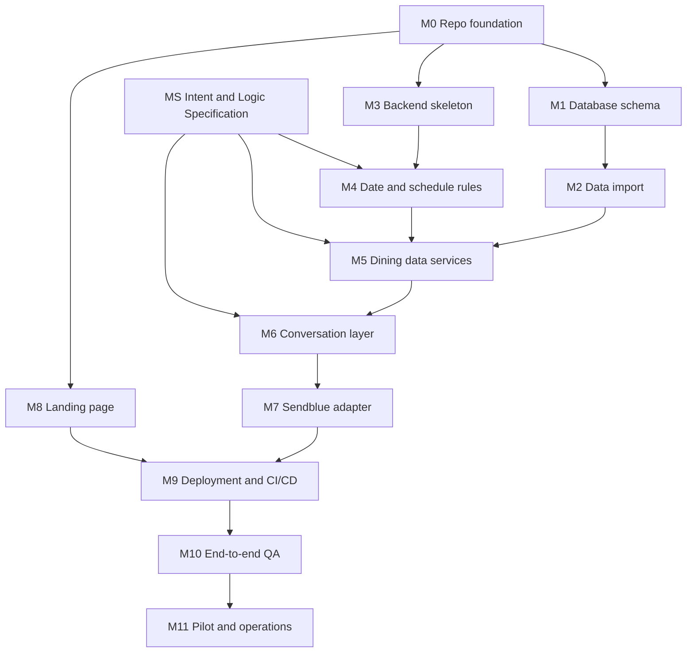

# Aggrey MVP Roadmap and Next Steps

**Status:** M0 (repository foundation) done on 2026-10-24, except step 1 (deferred) and the GitHub settings in step 8. No application code, `verify.sql`, or deployments exist yet. `db/schema.sql` and `db/seed.sql` were added on 2026-10-24.
**Created:** October 24, 2026
**Last updated:** October 24, 2026 (answers to N-03, N-12, N-13, N-14, N-15, N-16, N-17, N-19; holiday dinner sample added as dataset `mvp_v1_3`; new module MS and its draft spec; new questions N-40 to N-44; Intent and Logic Spec approved, N-40)
**Applies to:** the MVP defined in `Aggrey_MVP_PRD.md`, `Aggrey_Technical_Architecture.md`, and `Aggrey_MVP_Database_Schema.md`.

This roadmap breaks the MVP into modules. Each module lists its goal, dependencies, the inputs required from the project owner, step-by-step work, deliverables, and a definition of done. It adds no product features beyond the PRD.

**Rule for everyone building Aggrey:** if a value, credential, behavior, or data fact is not written in the project documents or confirmed in Section 1 below, do not invent it. Stop, record the question in Section 1, and wait for an answer.

---

## Contents

1. [Inputs needed from the project owner](#1-inputs-needed-from-the-project-owner)
2. [Known gaps and inconsistencies in the current documents](#2-known-gaps-and-inconsistencies-in-the-current-documents)
3. [Engineering standards (apply to every module)](#3-engineering-standards-apply-to-every-module)
4. [Module map and build order](#4-module-map-and-build-order)
5. [Modules](#5-modules)
6. [Acceptance test matrix](#6-acceptance-test-matrix)
7. [Out of scope for this roadmap](#7-out-of-scope-for-this-roadmap)

---

## 1. Inputs needed from the project owner

Every item below is a blocker for at least one module. Each has an ID so code, pull requests, and docs can reference it (for example, "blocked on N-07"). Answer inline by adding **Answer (date):** with the decision.

Where an option is labeled "suggested," it is a proposal for you to accept or reject. It is not a decision until you confirm it.

### 1A. Accounts, access, and credentials

| ID | What is needed | Blocks |
| --- | --- | --- |
| N-01 | Confirm GitHub repository `jaameyaw/aggrey` is the official repo and whether it should be public or private. **Answer (2026-10-24):** official repo, private. | M0 |
| N-02 | Supabase: create (or grant access to) the Aggrey project. Provide the project region and who owns the account. Credentials go into a secrets manager or `.env` locally, **never** into chat or Git. | M1, M2 |
| N-03 | Sendblue: account, plan name, assigned Aggrey phone number, API key ID and secret, and webhook signing secret. Confirm any plan limits (messages per day, contacts, iMessage vs SMS fallback). **Answer (2026-10-24), partial:** Sendblue falls back to SMS when the recipient does not use iMessage, so students without iPhones are supported. Public copy says "text," not "iMessage." Account, number, keys, and plan limits are still needed. | M7, M8, M10 |
| N-04 | Render: account and plan for the FastAPI service. Confirm whether a paid always-on instance is acceptable (see N-24). | M9 |
| N-05 | Vercel: account for the landing page. | M8, M9 |
| N-06 | Domain: will the landing page use a custom domain (provide it and DNS access), or the default Vercel URL? | M8, M9 |
| N-07 | Error tracking and uptime monitoring: choose a tool (for example Sentry, Better Stack, UptimeRobot, or Render logs only). Provide account access if a tool is chosen. | M9, M11 |

### 1B. Permissions, legal, and compliance

| ID | What is needed | Blocks |
| --- | --- | --- |
| N-08 | Written permission from Livingstone College and/or the dining services provider to use the menu, hours, and the college's name in Aggrey. | M8, M11 |
| N-09 | Can the landing page use the Livingstone College name, logo, or colors? If not, what wording is allowed? | M8 |
| N-10 | Privacy notice and terms text for the landing page (who writes it, and whether school approval is needed). Aggrey receives student phone numbers. | M8, M11 |
| N-11 | Opt-out handling: confirm what Sendblue does with "STOP"/"HELP" messages on your plan, and what Aggrey should reply. Check whether any messaging-registration rules apply to your number type. | M6, M7 |

### 1C. Product behavior decisions

| ID | Question | Blocks |
| --- | --- | --- |
| N-12 | **Default date.** If a student does not mention a date ("What's for dinner?"), should Aggrey use today in `America/New_York`? **Answer (2026-10-24):** Yes. With no date in the message, use today's date in `America/New_York` (read from `metadata.timezone`), never the server's UTC date. | M4, M6 |
| N-13 | **Supported date phrases.** PRD open decision 1. List exactly which phrases the first version must support. Suggested minimum: "today", "tonight", "tomorrow", and weekday names ("Monday"). Do explicit dates like "11/25" or "Nov 25" need support? Should "Monday" mean the next Monday or this week's Monday? **Answer (2026-10-24):** support "today", "tonight", "tomorrow", and weekday names. A weekday name means the next upcoming day with that name: today if today has that name, otherwise the next one, never a past date. Explicit dates ("11/25", "Nov 25") are not supported in the first version. | M4, M6 |
| N-14 | **Past meal today.** If a student asks "What's for lunch?" after lunch ended, should Aggrey say lunch is over and still show today's lunch, or point them to the next meal? **Answer (2026-10-24):** Say the meal is over and point to the next meal and its serving time, for example "Lunch is over. Dinner is served 5:00 to 8:00 PM." **Follow-ups answered (2026-10-24):** (a) Between 2:00 and 3:00 PM on a weekday, the next meal is Lite Lunch. The reply notes that Lite Lunch comes after the main lunch, so most lunch food is usually finished. (b) After the last meal of the day, Aggrey only says the meal is over for today. It does not point to tomorrow. (c) The reply gives the next meal's time only, not its menu. | M6 |
| N-15 | **"Is the caf open?"** The `hours` table stores *meal serving windows*, not building hours (schema section 20). Approve the reply meaning: "Lunch is being served until 2:00 PM" or "No meal is being served right now. Dinner starts at 5:00 PM." **Answer (2026-10-24):** it depends on the time asked. During a serving window: "Yes, lunch is being served until 2:00 PM." Outside every window, for example at 9:00 PM: "No, the caf is closed." **Follow-up answered (2026-10-24):** between meals and before the first meal, the reply also gives the next meal's start time, for example "No, the caf is closed right now. Lunch starts at 11:00 AM." After the last meal it only says the caf is closed. | M5, M6 |
| N-16 | **Holiday and break dinner.** The PRD allows a labeled weekday-dinner fallback. The schema doc says to prefer "verified holiday dinner menu is unavailable." Choose one: (a) show the weekday dinner menu clearly labeled as unconfirmed, or (b) give dinner hours only and say the menu is unavailable. **Answer (2026-10-24):** neither. Copy Saturday dinner into the data as the holiday and break dinner, labeled as a sample menu like holiday brunch. Applied as dataset `mvp_v1_3`: four `holiday_sample` dinner rows, the schema check now allows `holiday_sample` dinner, and the metadata key `holiday_dinner_fallback` is replaced by `holiday_dinner_source = saturday_sample`. Replace the rows if a real holiday dinner menu arrives (N-26). | M5, M6 |
| N-17 | **Food matching.** "Do they have wings today?" matches nothing in the current data. Approve the matching rules: case-insensitive partial match, basic plurals ("wing" vs "wings"), and "&" vs "and". Should there be a synonym list (for example "mac" matches "Mac & Cheese")? If yes, who maintains it? **Answer (2026-10-24):** Food matching rules and any synonym list are defined in the Intent and Logic Specification (module MS) and approved with it (N-40). Code must not add matching rules or synonyms that are not in the approved spec. | MS, M5, M6 |
| N-18 | **Reply copy and tone.** Approve the reply templates produced in M6 (wording, emojis yes or no, 12-hour time format, and how stations are shown). | M6 |
| N-19 | **Long replies.** "Show everything" for weekday lunch is about 20+ items. After checking Sendblue's message length limits, should a long reply be one message or split into several? **Answer (2026-10-24):** Avoid long unrequested replies. A generic "What's for lunch?" asks which station. If the student does not know, Aggrey gives the lunch menu by station. Replies that list several stations are grouped by station. If a reply exceeds Sendblue's length limit (M7 step 1), split it only between stations, never inside one station. **Follow-up answered (2026-10-24):** "I don't know" gets a one-line explanation of the stations, then the lunch menu grouped by station. The PRD is updated to match. | M6, M7 |
| N-20 | **Follow-up memory.** How long should Aggrey remember a pending lunch station question? Suggested: 10 minutes. | M6 |
| N-21 | **Per-sender rate limit.** Should Aggrey limit how many messages one number can send per minute? Suggested: yes, with a short "slow down" reply. Approve the number. | M7 |
| N-22 | **First-time message.** Should the first reply to a new number include a short intro and example questions, or just answer? | M6 |
| N-40 | **Intent and Logic Specification sign-off.** Review and approve `Aggrey_Intent_Logic_Spec.md` (drafted 2026-10-24 in module MS): the intent list, the slots each intent needs, defaults, the behavior and reply for each case, food matching and synonyms, and the phrase corpus. Nothing in M4–M6 is "supported" until it is in the approved spec. **Answer (2026-10-24):** approved by the project owner after nine review fixes, which are listed in spec section 14. All **Proposed** rules are now decided. Section 9.4 answers: "burger" and "hamburger" match the patties and Veggie Burger, not the bun; "fries" no longer matches Stir Fry; the egg noodle and green bean matches stay; there is no wings synonym. N-11, N-18, N-20, N-22, and N-41 to N-44 stay open. | MS, M4, M5, M6 |
| N-41 | **Menu question with no meal.** "What's on the menu today?" names no meal. Suggested: ask which meal, listing only the meals served on that day's schedule. | MS, M6 |
| N-42 | **Brunch stations.** Weekend brunch has 3–4 stations and 18–22 items (Saturday has 22). The PRD asks for a station only at weekday lunch. Suggested: show all of brunch grouped by station, split per N-19, with no station prompt. | MS, M6 |
| N-43 | **Which data counts as provisional.** `holidays.verification_status` has four values: `calendar_date; mvp_hours`, `calendar_date; latest_hours`, `calendar_date; user_confirmed_hours`, and `pending_confirmation`. Suggested: only `pending_confirmation` is labeled "not yet confirmed" in replies. | MS, M4, M6 |
| N-44 | **Food lookup for a finished meal.** At 3:30 PM, "Do they have onion rings today?" matches lunch, which is over. Suggested: report the match and say that lunch is over for today. | MS, M6 |

### 1D. Data confirmations (from the dining manager)

| ID | Question | Blocks |
| --- | --- | --- |
| N-23 | Confirm the menu really repeats **every week** all semester, not a multi-week cycle. The data model depends on this. | M2, M11 |
| N-25 | Confirm the virtual classes, reading day, and exams hours (2026-11-30 to 2026-12-12). They are provisional now. | M2, M11 |
| N-26 | Provide the real holiday and break dinner menu, if one exists. | M2, M5 |
| N-27 | Provide the Lite Lunch food menu, if one exists. If not, confirm "unavailable" is the permanent answer. | M2 |
| N-28 | Summer operations: the data says "reduced schedule" with no dates. After 2027-07-05, Aggrey would apply normal weekday rules. Provide summer dates and hours, or decide the service end date for the pilot. | M2, M11 |
| N-29 | Calendar coverage: the holiday data ends 2027-07-05. Who supplies the 2027–2028 academic calendar, and by when? | M11 |
| N-30 | Who tells the Aggrey team when the menu or hours change, and how? (`update_policy = manual`.) | M11 |

### 1E. Engineering decisions

| ID | Question | Blocks |
| --- | --- | --- |
| N-24 | **Hosting tier.** Some free hosting tiers sleep when idle, which can slow or miss webhook replies. Approve an always-on paid Render instance for the pilot, or accept the risk after testing. | M9 |
| N-31 | **Repository location.** The repo is inside OneDrive. Syncing `.git`, `.venv`, and `node_modules` through OneDrive often causes file locks and conflicts. Suggested: move the working copy outside OneDrive (for example `C:\dev\aggrey`), with GitHub as the backup. Approve or reject. **Deferred (2026-10-24):** M0 step 1 was skipped; the working copy stays in OneDrive for now. Expect OneDrive to sync `backend/.venv`; if file locks or sync conflicts appear, move the clone outside OneDrive. | M0 |
| N-32 | **Folder layout.** The architecture doc suggests `backend/`, `web/`, `db/`, `data/`, and `docs/`. Approve moving the existing docs into `docs/` and `mvp dining data/` into `data/` (removing the space in the folder name). **Answer (2026-10-24):** approved and applied in M0. The landing page folder is named `frontend/` instead of `web/` (decided 2026-10-24). | M0 |
| N-33 | **Database access method from FastAPI.** Choose one: (a) Supabase Python client over HTTPS using the secret key (matches the env names in the architecture doc; bypasses RLS), or (b) direct Postgres connection via the Supabase connection pooler, ideally with a dedicated read-only role. Option (b) needs a small approved addition to the audited schema: a read-only role and select policies. **Answer (2026-10-24):** Option (b). The backend reads as a dedicated least-privilege Postgres role (`aggrey_readonly`, SELECT only), via the Supabase pooler. Implemented by `db/migrations/001_readonly_role.sql`; rationale in `docs/adr/0001-database-access-method.md`. | M1, M3, M5 |
| N-34 | **Tooling versions.** Suggested: Python 3.12 with `uv` for dependencies; Node.js current LTS with `pnpm` (or `npm`). Approve or specify. **Answer (2026-10-24):** Python 3.13 with `uv`; Node.js 24 with `pnpm`. | M0 |
| N-35 | **Local database for tests.** Is Docker available on your development machine? If yes, integration tests can run against a local Postgres or the Supabase CLI. If not, tests run against a separate Supabase test project (needs N-02 access). **Note (2026-10-24):** Docker is installed on the project owner's machine. Still confirm for the database developer's machine. | M1, M10 |
| N-36 | **Environments.** One Supabase project (production only), or two (staging plus production)? Same question for Render and Sendblue numbers. | M9 |
| N-37 | **Usage metrics without storing messages.** The PRD wants counts of questions, unique testers, and top intents. Approve logging intent plus a salted hash of the phone number (no message text, no raw numbers). | M7, M11 |
| N-38 | **Pilot plan.** Who are the testers, how many, what start date, and how long does the pilot run? | M10, M11 |
| N-39 | **Code review.** Who reviews and approves pull requests? If solo, is AI-assisted review plus CI acceptable as the merge gate? **Answer (2026-10-24):** two developers. The project owner leads; a second developer owns the database and Supabase work (M1, M2) on the `database/supabase` branch. Every pull request needs passing CI and one approval from the other developer. | M0 |

---

## 2. Known gaps and inconsistencies in the current documents

Resolve these before or during M0. Do not silently work around them.

1. ~~`Aggrey_Technical_Architecture.md` refers to `Aggrey_MVP_PRD_Build_Ready.md`.~~ **Fixed 2026-10-24 (M0):** the reference now points to `Aggrey_MVP_PRD.md`.
2. The architecture doc refers to `db/schema.sql`, `db/seed.sql`, and `db/verify.sql`. **Updated 2026-10-24:** `schema.sql` and `seed.sql` were added and moved into `db/` in M0. Checked on 2026-10-24:
   - `schema.sql` is identical to the SQL in `Aggrey_MVP_Database_Schema.md` section 4.
   - `seed.sql` contains 223 menu, 10 hours, 11 holiday, and 11 metadata rows, which matches dataset `mvp_v1_2`. **Updated 2026-10-24 (N-16):** dataset `mvp_v1_3` adds four holiday dinner rows, so `seed.sql` now has 227 menu rows. `schema.sql` and the schema doc section 4 were changed together and are still identical.
   - `verify.sql` still does not exist (M1 creates it).
   - The script that generated `seed.sql` from the workbook is not in the repo (M2 adds one).
   - Both files are now in `db/` (M0, N-32).
3. The PRD mentions a "future-development list." It is not in the repo. Nothing from it may be built until it exists and is approved.
4. ~~Holiday and break dinner wording differs between the PRD and the schema doc.~~ **Resolved 2026-10-24 (N-16):** both now describe the `holiday_sample` dinner copied from Saturday.
5. ~~The README says "iMessage." The PRD says "text" via Sendblue.~~ **Resolved 2026-10-24 (N-03):** SMS is supported through Sendblue's fallback. The README now says "text."
6. ~~All project documents, `schema.sql`, `seed.sql`, and this roadmap are untracked in Git.~~ **Fixed 2026-10-24 (M0):** committed as "docs: add MVP specification."
7. **Confirmed 2026-10-24:** the metadata key `holiday_brunch_source = saturday_sample` only records where the holiday sample came from. The runtime menu scope is `holiday_sample`. Code must query `menu_scope = 'holiday_sample'` and must never query or copy Saturday (`day_of_week = 6`) rows for a holiday or break. M5 implements this rule and tests it.
8. ~~**Lunch "I don't know" behavior conflict.**~~ **Resolved 2026-10-24:** a one-line explanation of the stations, then the lunch menu grouped by station. The PRD and acceptance row 5 are updated.
9. **Intent list mismatch.** PRD FR-2 names four intents: menu lookup, hours lookup, food-item lookup, and unsupported/unclear. M6 below also names "open-now" and "help," and N-11 adds opt-out keywords. The Intent and Logic Specification (MS) must settle the final list, and the PRD should then be updated to match. The draft spec (section 4) proposes keeping the PRD's four dining intents, treating "open now" as part of hours lookup, and adding `follow_up`, `help`, and `opt_out` as conversation controls. This is resolved when N-40 is signed off.

---

## 3. Engineering standards (apply to every module)

### 3.1 Source control and review

- Protect the `main` branch: no direct pushes. Every change goes through a pull request with passing CI and one approval (see N-39).
- Use short-lived feature branches named by module, for example `m4/schedule-resolver`.
- Use Conventional Commits (`feat:`, `fix:`, `test:`, `docs:`, `chore:`).
- Keep pull requests small and focused on one module step.
- Reference roadmap IDs in pull request descriptions (for example "Implements M4.3, blocked on N-13 for weekday names").

### 3.2 Code quality

- **Python:** `ruff` for lint and format, `mypy` (strict) for types, `pytest` for tests, `pydantic` for request and config validation.
- **TypeScript:** `strict` mode, ESLint, Prettier.
- Run all checks with pre-commit hooks locally and again in CI.
- Pin dependencies with a lockfile (`uv.lock`, `pnpm-lock.yaml`). Enable Dependabot or Renovate for updates.
- Add `.editorconfig` and `.gitattributes` with consistent line endings. This matters on Windows.

### 3.3 Architecture boundaries (from the PRD guardrails)

- Business rules (dates, schedules, meals, menus) are plain Python with no imports from FastAPI, Sendblue, or the database driver.
- Database access lives behind a repository interface so rules can be tested with fakes.
- Sendblue code lives only in the messaging adapter. Replacing Sendblue must not touch business rules.
- **Inject the clock.** Domain code never calls `datetime.now()` directly. It receives a "now" value so tests can pin any date and time.
- Never hard-code menu items, hours, holiday dates, or station counts. Read them from the database.

### 3.4 Configuration and secrets

- All configuration comes from environment variables, validated at startup with `pydantic-settings`. Fail fast with a clear error if anything required is missing.
- Commit `.env.example` with variable **names only**. Add `.env` to `.gitignore`.
- Store secrets only in Render, Vercel, and Supabase dashboards or a password manager. Never in code, logs, issues, or chat.
- Enable GitHub secret scanning and push protection.
- The timezone comes from `metadata.timezone`. Fail clearly if it is missing or invalid (architecture section 9).

### 3.5 Testing

- Write tests before or alongside each rule (PRD: "Add tests before expanding supported phrasing").
- Unit tests for every business rule, driven by fixed dates. Integration tests against a real Postgres with the real schema and seed (N-35). Contract tests for the Sendblue adapter using recorded sample payloads.
- Coverage target suggestion: 90%+ on domain and conversation modules. Coverage is a guide, not the goal; the acceptance matrix in Section 6 is the real bar.
- CI runs the full test suite on every pull request.

### 3.6 Reliability, security, and privacy

- Bounded timeouts on every outbound call (database, Sendblue).
- On failure, send a short honest message ("I can't reach the dining data right now") or nothing. Never a guessed answer.
- Do not blindly retry a send that may have succeeded; it can produce duplicate texts.
- Structured JSON logs with request ID, intent, duration, and error category. **No message text, no raw phone numbers, no secrets** (architecture section 8).
- Validate and size-limit all inbound requests. HTTPS only.

### 3.7 Documentation

- `README.md` covers setup, run, test, and deploy steps for a new developer.
- Record significant decisions as short Architecture Decision Records in `docs/adr/` (for example `0001-database-access-method.md` after N-33).
- Update this roadmap when a module finishes or a Section 1 item is answered.

### 3.8 Definition of done (every module)

- Code merged to `main` through a reviewed pull request with green CI.
- Tests written and passing; relevant acceptance rows in Section 6 pass.
- No linter or type errors.
- Docs updated (README, ADRs, this roadmap).
- No open Section 1 item silently assumed in code.

---

## 4. Module map and build order



This follows the architecture doc's order: database, then import, then schedule and menu services, then the conversation, Sendblue, the landing page, tests, and the pilot. M8 (landing page) can be built in parallel once M0 is done, but cannot go live until the number (N-03) exists.

MS (Intent and Logic Specification) is a document, not code. It needs no other module and should start now, in parallel with M0–M3. M4, M5, and M6 cannot be finished until it is approved (N-40).

---

## 5. Modules

### M0. Repository foundation

**Goal:** a clean, reviewable repository that any developer can clone and run checks on.
**Depends on:** nothing.
**Needs from you:** N-01, N-31, N-32, N-34, N-39.

**Steps**

1. Decide the repo location (N-31). If moving out of OneDrive, clone fresh from GitHub to the new path.
2. Commit the existing documents, data workbook, `schema.sql`, `seed.sql`, and this roadmap as they are, in one "docs: add MVP specification" commit, so later edits show as diffs.
3. Apply the approved folder layout (N-32). Suggested:
   ```text
   backend/   FastAPI app, domain rules, adapters, tests
   frontend/  Next.js landing page
   db/        schema.sql, seed.sql, verify.sql, seed generator
   data/      Aggrey_MVP_Data.xlsx and its Markdown mirror
   docs/      PRD, architecture, schema reference, roadmap, adr/
   ```
4. Fix the document issues listed in Section 2, items 1 and 6.
5. Add `.gitignore` (Python, Node, `.env`, OS files), `.editorconfig`, `.gitattributes`.
6. Scaffold `backend/` with the approved Python version and package manager (N-34): `pyproject.toml`, ruff, mypy, pytest, pre-commit configuration.
7. Add a GitHub Actions workflow that runs lint, type check, and tests for `backend/` (and `frontend/` once it exists).
8. Turn on branch protection, secret scanning, push protection, and Dependabot.
9. Add `CONTRIBUTING.md` or a README section describing the branch, commit, and review rules from Section 3.1.

**Deliverables:** committed docs, folder structure, tooling configs, CI workflow, protected `main`.
**Done when:** a fresh clone can run `lint`, `typecheck`, and `test` commands with one documented command each, and CI is green on an empty test suite.

**Progress (2026-10-24):**

| Step | Status |
| --- | --- |
| 1. Repo location | Skipped by decision; N-31 deferred |
| 2. Commit docs as-is | Done |
| 3. Folder layout | Done (`docs/`, `db/`, `data/`, `backend/`, `frontend/`) |
| 4. Section 2 items 1 and 6 | Done |
| 5. `.gitignore`, `.editorconfig`, `.gitattributes` | Done |
| 6. Backend scaffold | Done: Python 3.13, uv, ruff, mypy (strict), pytest, pre-commit |
| 7. CI workflow | Done: `.github/workflows/ci.yml`. Needs a first green run on GitHub. |
| 8. GitHub settings | Dependabot config done (`.github/dependabot.yml`). Branch protection, secret scanning, and push protection must be turned on in GitHub settings. On GitHub Free, private repos do not offer branch protection or secret-scanning push protection, so this may need GitHub Pro or Team, or the repo owner enforcing the rule by agreement. |
| 9. Contributing rules | Done: `CONTRIBUTING.md` and a pull request template |

The database developer works on the `database/supabase` branch (N-39).

---

### MS. Intent and Logic Specification

**Goal:** one approved document that says exactly what Aggrey understands and how it answers. Aggrey is rule-based, so the rules must be written down before they are coded. Without this document, each developer would decide behavior in code, and the tests would have nothing to check against.
**Depends on:** nothing (documents only). Start now, in parallel with M0–M3.
**Status:** `docs/Aggrey_Intent_Logic_Spec.md` approved 2026-10-24 (N-40). The open items below are still pending.
**Needs from you:** N-11, N-18, N-20, N-21, N-22, N-41, N-42, N-43, N-44. N-12, N-13, N-14, N-15, N-16, N-17, N-19, and N-40 are answered.

**Steps**

1. Create `Aggrey_Intent_Logic_Spec.md`. Use only behavior from the PRD, the schema doc, and answered Section 1 items. Mark anything not yet decided as **open** with its N-number. Do not fill gaps with guesses.
2. **Intent list.** Settle the final intents (Section 2, item 9). For each intent, write:
   - What it means, in one sentence.
   - Trigger words and example phrases.
   - Slots it uses: meal, date, station, food keyword. Say which are required and which are optional.
   - Defaults when a slot is missing. Missing date means today in `America/New_York` (N-12).
   - The data it reads (menus, hours, holidays, metadata) and the M5 service it calls.
   - Every outcome, with the meaning of the reply for each one.
3. **Priority rules.** Say what happens when a message matches more than one intent or meal (for example "Is the caf open for lunch?" or "pizza for dinner"). Use a fixed order, written as a table.
4. **Decision tables** for the cases that depend on schedule and time:
   - Meal not served on that schedule (Saturday lunch, holiday breakfast).
   - Meal already over today (N-14), including the Lite Lunch window and after the last meal.
   - "Is the caf open?" inside and between serving windows (N-15).
   - Holiday and break menus: `holiday_sample` brunch, and dinner per N-16.
   - Provisional data (for example the virtual classes period).
5. **Lunch station flow** (PRD FR-12): generic question, direct station, "I don't know" (Section 2, item 8), "show everything," short follow-up, and context expiry (N-20).
6. **Food matching** (N-17): normalization steps, partial matching, plurals, "&" vs "and," the synonym list, and who maintains it. The wording for no match is "not listed on the stored menu," never "not served."
7. **Station aliases:** for example "grill" and "burgers" for Grill / sandwich. Only aliases written here are supported.
8. **Long replies** (N-19): grouping by station and the splitting rule.
9. **Special messages:** unclear text, help, first-time sender (N-22), and STOP/HELP (N-11).
10. **Phrase corpus.** List example messages and their expected intent, meal, date, station, and food keyword, including the README and PRD examples. The corpus is a table in the spec for review. Once `backend/` exists, convert it to `tests/conversation/phrases.yaml`, the test input for M6.
11. Review the spec with you, resolve the open items, and record sign-off (N-40). After sign-off, every change to supported behavior updates the spec and the phrase corpus first, then the code.

**Deliverables:** `Aggrey_Intent_Logic_Spec.md`, `phrases.yaml`, PRD updates for Section 2 items 8 and 9.
**Done when:** you have signed off (N-40), no item is marked open without an N-number, and every row in Section 6 can be traced to a rule in the spec.

---

### M1. Database schema on Supabase

**Goal:** the audited four-table schema running on Supabase, with a repeatable verification script.
**Depends on:** M0.
**Needs from you:** N-02, N-33, N-35, N-36.

**Steps**

1. `db/schema.sql` already exists and matches `Aggrey_MVP_Database_Schema.md` section 4 (checked 2026-10-24). Do not edit it. Add a CI check that fails if the file and the doc's section 4 SQL drift apart. Do not redesign tables (architecture section 5).
2. If N-33 chooses a dedicated read-only role, write that change as a separate, reviewed migration file (for example `db/migrations/002_readonly_role.sql`) and record an ADR. Do not edit the audited file silently.
3. Write `db/verify.sql` to check:
   - The four tables, two enums, triggers, and RLS settings exist.
   - Row counts after seeding: 227 menus, 10 hours, 11 holidays, 11 metadata (dataset `mvp_v1_3`).
   - No overlapping holiday ranges.
   - Every weekday (1–5) has breakfast, lunch, and dinner rows. Every weekend day (6–7) has brunch and dinner rows.
   - All five lunch stations exist for each weekday.
   - No `lite_lunch` menu rows exist (they were never supplied).
   - `holiday_sample` rows exist, are brunch or dinner only, and have a null weekday.
4. Set up the local test database (N-35): Docker Postgres or the Supabase CLI, or a dedicated Supabase test project.
5. Run `schema.sql` on the test database first, then on the real Supabase project (fresh project only; the script creates types and is not re-runnable).
6. Confirm in the Supabase dashboard that the anonymous and authenticated roles cannot read any table.

**Deliverables:** `db/schema.sql`, `db/verify.sql`, any approved extra migration, short `db/README.md` with run instructions.
**Done when:** the schema runs cleanly on a fresh database, and the structural checks in `verify.sql` pass on the **actual Supabase project** (architecture section 10).

---

### M2. Data import from the workbook

**Goal:** load `Aggrey_MVP_Data.xlsx` into PostgreSQL through a validated, repeatable, transactional process.
**Depends on:** M1.
**Needs from you:** N-23, N-25, N-26, N-27, N-28. Import can start with current data; these answers may change data later.

A `db/seed.sql` already exists (added 2026-10-24). It says it was generated from the workbook, and its row counts match `mvp_v1_3` (227 / 10 / 11 / 11), but the script that produced it is not in the repo. Use it for M1 testing now. This module adds the generator so future data changes are repeatable and reviewable.

**Steps**

1. Write a seed generator (Python, for example `db/generate_seed.py` using `openpyxl`) that reads the four sheets: `menus`, `hours`, `holidays`, `metadata`. Its first job is to reproduce the existing `seed.sql` exactly. Any difference is a data question for you, not something to fix silently.
2. Validate before writing anything, and fail with clear row-level errors on:
   - Wrong or missing column names.
   - Meal types or schedule types outside the enums.
   - `day_of_week` outside 1–7, or set on `holiday_sample` rows.
   - Blank station or food names, non-positive `display_order`.
   - End time not after start time, end date before start date, overlapping holiday ranges.
   - Duplicate items within the same day, meal, and station.
   - Row counts different from the expected dataset version (`mvp_v1_3`: 227 / 10 / 11 / 11).
3. Generate `db/seed.sql` deterministically (same input gives byte-identical output). Keep the conventions of the existing file: one transaction, `ON CONFLICT DO NOTHING` for menus, and `ON CONFLICT ... DO UPDATE` for hours, holidays, and metadata, so re-running does not duplicate rows.
4. Add a parity check that compares the workbook against `Aggrey_MVP_Data.md` and fails if they differ. The workbook stays canonical; the Markdown is a mirror.
5. Run the seed on the test database, run `verify.sql`, then repeat on Supabase.
6. Document the known limitation (schema section 20): the seed does not remove deleted or renamed foods. Before the first real menu change (M11), propose and get approval for a full-sync approach (for example "truncate and reload in one transaction, keyed by dataset version").
7. Add unit tests for the generator's validation rules using small broken sample workbooks.

**Deliverables:** `db/generate_seed.py`, `db/seed.sql`, tests, parity check in CI.
**Done when:** the generator reproduces the existing `seed.sql` (or every difference is explained and approved), `verify.sql` passes all count and content checks on Supabase, re-running the seed changes nothing, and CI fails if the workbook and Markdown drift apart.

---

### M3. Backend skeleton

**Goal:** a running FastAPI service with configuration, logging, a health check, and a database access layer, with no dining logic yet.
**Depends on:** M0. Database access needs M1.
**Needs from you:** N-33, N-34.

**Steps**

1. Create the FastAPI app with this internal layout (names are suggestions):
   ```text
   backend/aggrey/
     api/          routes: /health, /webhooks/sendblue (stub)
     config.py     pydantic-settings, validated at startup
     domain/       pure rules: dates, schedules, meals (M4)
     services/     menu, hours, food search (M5)
     conversation/ interpreter, context, formatter (M6)
     adapters/     db repository, sendblue client (M5, M7)
     logging.py    structured JSON logging
   ```
2. Implement `config.py`. Variable names come from the architecture doc and change only if N-33 changes the DB access method.
3. Implement `GET /health`. It returns only status and app version. No secrets, no data.
4. Implement the database repository interface (methods such as `find_overrides(date)`, `get_hours(schedule, meal)`, `get_menu(scope, weekday, meal, station=None)`, `search_food(...)`, `get_metadata(key)`) and one real implementation using the approved access method. Use parameterized queries only.
5. Add timeouts and connection handling for the database client.
6. Add structured logging with a request ID per inbound request.
7. Add a fake (in-memory) repository for unit tests.
8. Add a startup check that loads `metadata.timezone` and fails clearly if it is missing or invalid.

**Deliverables:** runnable app, repository interface plus real and fake implementations, health endpoint, logging.
**Done when:** the app starts locally against the test database, `/health` works, missing config fails fast with a readable message, and repository integration tests pass against the seeded database.

---

### M4. Date and schedule rules (pure domain logic)

**Goal:** given a "now" and a requested date, decide the schedule type and which meals are valid. No I/O.
**Depends on:** M3 (structure only).
**Needs from you:** N-40 (approved spec from MS). N-12 and N-13 are answered.

**Steps**

1. **Date resolution.** Convert supported phrases to a calendar date in `America/New_York`, using the injected clock. If the message has no date, use today in `America/New_York` (N-12). Compute "today" from the local time, not the UTC date. Implement only phrases approved in N-13 and listed in the spec. Unsupported phrases return "unrecognized date," never a guess.
2. **Schedule resolution** (schema section 8), in this exact order:
   1. Holiday or break override from the database for that date (inclusive range). If more than one row matches, raise a data error. Do not pick one.
   2. Saturday or Sunday gives `weekend`.
   3. Otherwise `weekday`.
3. Carry the override's `name`, `verification_status`, and `notes` forward so replies can disclose provisional status (for example the virtual classes period).
4. **Meal validation** (schema section 9):
   - `weekday`: breakfast, lunch, lite_lunch, dinner.
   - `weekend`, `holiday`, `break`: brunch, dinner.
   - Invalid combinations (Saturday lunch, holiday breakfast) return a structured "not served, here is what is" result, not an error.
5. **Current-meal and next-meal detection** for "is it open" questions (N-15) and finished meals (N-14): compare the local time with that day's serving windows from `hours`. Return the current meal (if any), whether the asked-about meal is already over, and the next meal with its start and end times. Window boundary rules (is 2:00 PM lunch or Lite Lunch?) and the N-14 open follow-ups must be written as tests and confirmed in the spec.
6. Unit tests for every row in Section 6 that involves dates or schedules, including DST changes (2026-11-01 and 2027-03-14) and midnight boundaries.

**Deliverables:** `domain/dates.py`, `domain/schedule.py`, `domain/meals.py`, tests.
**Done when:** all schedule and date rows in Section 6 pass with a fixed clock and a fake repository.

---

### M5. Dining data services

**Goal:** turn a resolved date, schedule, meal, and optional station or food keyword into structured facts from the database, with missing-data rules applied.
**Depends on:** M2, M4.
**Needs from you:** N-26, N-40 (food matching rules from the approved spec, per N-17). N-15 and N-16 are answered.

**Steps**

1. **Menu service** (schema section 10):
   - Weekday and weekend: `menu_scope = 'weekly'`, ISO weekday, meal, optional station. Return **all** rows ordered by station, then `display_order`.
   - Holiday and break brunch: query `menu_scope = 'holiday_sample'` only. Mark the result as provisional. Never query or copy Saturday (`day_of_week = 6`) rows for a holiday or break. The metadata key `holiday_brunch_source = saturday_sample` only records where the sample came from; code must not read it to choose rows. Add a test that fails if holiday brunch ever returns `weekly` rows.
   - Holiday and break dinner (N-16): query `menu_scope = 'holiday_sample'` and `meal_type = 'dinner'` only, and mark the result as provisional, exactly like holiday brunch. Never query Saturday's `weekly` rows or the calendar weekday's dinner. Add a test that fails if holiday dinner ever returns `weekly` rows.
   - Lite Lunch: always return "menu unavailable" with its hours.
   - Zero rows for a valid meal: return "menu unavailable." Never fall back to another day.
2. **Station handling:** read the station list from the menu rows for that day and meal. Never hard-code five stations (schema section 18).
3. **Hours service** (schema section 11): look up start and end times for a schedule and meal. Zero rows gives "hours unavailable." Carry provisional flags from M4.
4. **Food search** (schema section 12): search only meals valid for the resolved schedule, using only the matching rules and synonym list in the approved Intent and Logic Specification (N-17, N-40). Return meal, station, and item for every match. No match means "not listed on the stored menu," never "not served."
5. Return typed result objects (dataclasses or pydantic), not strings. Formatting happens in M6.
6. Integration tests against the seeded database for every menu and hours row in Section 6.

**Deliverables:** `services/menu.py`, `services/hours.py`, `services/food_search.py`, tests.
**Done when:** every data-related row in Section 6 passes against the real seeded database.

---

### M6. Conversation layer

**Goal:** understand a student's message, keep short follow-up context, and produce a short, accurate reply string.
**Depends on:** M5.
**Needs from you:** N-11, N-18, N-20, N-22, N-40 (approved spec from MS). N-12, N-13, N-14, N-16, N-17, and N-19 are answered, with follow-ups tracked in the spec.

**Steps**

1. **Start from the approved spec.** The Intent and Logic Specification and its phrase corpus (`tests/conversation/phrases.yaml`) come from module MS. They define what "supported" means. M6 implements them and does not add behavior the spec does not describe.
2. **Rule-based interpreter.** No LLM. Normalize text (lowercase, trim, strip punctuation, collapse spaces) and detect:
   - Intent: exactly the intents in the approved spec (see Section 2, item 9).
   - Meal: breakfast, lunch, Lite Lunch, dinner, brunch.
   - Date phrase (N-13).
   - Station name and approved aliases (for example "grill," "burgers").
   - Food keyword for food lookups.
   - Opt-out and help keywords (N-11).
3. **Lunch station flow** (PRD FR-12):
   - A generic weekday lunch question asks which station, listing the stations read from the data.
   - A direct station question ("What's at the pizza station?") answers immediately.
   - "I don't know" gives a one-line explanation of the stations, then the lunch menu grouped by station (N-19).
   - "Show everything" or "all" returns every station, grouped by station.
   - A short follow-up ("Pizza") uses the pending lunch context.
4. **Context store:** keyed by sender, holding the pending meal, date, and awaiting-station flag. Expires after the time set in N-20. In memory and bounded in size for the single-instance pilot (architecture section 7). Put it behind an interface so a durable store can replace it later.
5. **Response formatter:** turn M5 results into the approved templates (N-18). Rules:
   - Always state the day being described ("Today (Wed)…", "Tomorrow…").
   - Label anything provisional or unverified in plain words.
   - Use 12-hour times unless N-18 says otherwise.
   - If the asked-about meal is already over today, say so and give the next meal and its serving time (N-14). Do not show the finished meal's menu.
   - Group multi-station replies by station. If a reply exceeds Sendblue's length limit, split it only between stations (N-19).
6. **Unclear or unsupported messages:** reply with 2–3 example questions. Never guess.
7. Unit tests: every phrase in the corpus, every station-flow path, context expiry, and every Section 6 row end to end through interpreter, services (fake repository), and formatter.

**Deliverables:** `conversation/interpreter.py`, `conversation/context.py`, `conversation/formatter.py`, approved reply templates, tests.
**Done when:** the approved phrase corpus passes 100%, all Section 6 conversation rows pass, and you have approved sample replies.

---

### M7. Sendblue messaging adapter

**Goal:** receive student messages from Sendblue securely and send replies, without leaking Sendblue details into business logic.
**Depends on:** M6.
**Needs from you:** N-03, N-11, N-19, N-21, N-37.

**Steps**

1. **Verify everything against current Sendblue documentation before coding**, and record the findings in `docs/adr/`:
   - Webhook signing header name and verification method (the architecture doc names `sb-signing-secret`; confirm it).
   - Inbound payload fields: sender number, message text, message ID, and how outbound and status events are distinguished.
   - Send-message API endpoint, authentication headers, response format, rate limits, and maximum message length.
   - Webhook retry and timeout behavior.
   - iMessage vs SMS behavior on your plan. SMS fallback is supported (N-03), so confirm the length limit for **both** channels. SMS limits are usually much lower, and they drive the N-19 splitting rule. Also confirm whether split messages arrive in order.
2. Implement `POST /webhooks/sendblue`:
   - Reject requests without a valid secret, using constant-time comparison.
   - Enforce a maximum body size and validate the payload with a pydantic model.
   - Ignore events that are not student-initiated inbound messages (including Aggrey's own outbound echoes).
   - Deduplicate by provider message ID using a bounded in-memory store with a TTL. Document that this is not durable (architecture section 7).
   - Apply the per-sender rate limit (N-21).
   - Return a fast success response to Sendblue. Do the processing and reply in a way that stays within Sendblue's webhook timeout (confirmed in step 1).
3. Implement the Sendblue client: send reply, bounded timeout, no automatic retry on ambiguous failures, structured error logging.
4. Log only request ID, intent, duration, outcome, and (if N-37 is approved) a salted hash of the sender.
5. Save sanitized sample payloads from the docs as test fixtures. Write contract tests for valid, invalid-signature, malformed, duplicate, outbound-echo, and oversized requests.
6. Write a test that the business logic modules never import the Sendblue adapter.

**Deliverables:** webhook route, Sendblue client, ADR of verified provider behavior, fixtures, tests.
**Done when:** all webhook security and duplicate tests pass, and a local tunnel test (for example ngrok or Cloudflare Tunnel, against a Sendblue test setup) returns a real reply to your phone.

---

### M8. Landing page

**Goal:** one mobile-friendly page that explains Aggrey and opens Messages to the Aggrey number.
**Depends on:** M0. Launch depends on N-03.
**Needs from you:** N-03, N-06, N-08, N-09, N-10.

**Steps**

1. Scaffold Next.js with TypeScript (strict) in `frontend/`, with ESLint and Prettier added to CI. **Done 2026-10-24** on branch `m8/frontend-scaffold`: Next.js 16, pnpm, App Router, CSS Modules, a CI job for lint, type check, and format, and a placeholder page that uses only README copy. Steps 2–6 are still open (branding N-09, privacy N-10, device tests, Lighthouse).
2. Content: what Aggrey does, 3–4 sample questions taken from the approved phrase corpus, the visible phone number, a "Text Aggrey" button, and the privacy notice or link (N-10). Use only approved school naming and branding (N-09).
3. The only configuration value is `NEXT_PUBLIC_AGGREY_PHONE_NUMBER`. Fail the build if it is missing. No database access and no other secrets.
4. Build the `sms:` link and **test it on a real iPhone and a real Android phone**. Keep the number visible as text for desktop users.
5. Accessibility: semantic HTML, sufficient color contrast, descriptive link text, works at 320 px width. Run Lighthouse and fix accessibility issues.
6. Basic SEO and social metadata (title, description).

**Deliverables:** `frontend/` app, test notes for iPhone and Android.
**Done when:** the page passes CI, scores well on Lighthouse accessibility, and tapping the button opens Messages with the correct number on both phone types.

---

### M9. Deployment and CI/CD

**Goal:** repeatable deployments for the backend, landing page, and database.
**Depends on:** M7, M8.
**Needs from you:** N-02, N-04, N-05, N-06, N-07, N-24, N-36.

**Steps**

1. **Render (backend):** create the web service from `backend/`, set environment variables in the Render dashboard, configure the health check on `/health`, and run exactly **one instance** (architecture section 7). Pick the plan approved in N-24.
2. **Vercel (frontend):** connect `frontend/` as the project root directory, set `NEXT_PUBLIC_AGGREY_PHONE_NUMBER`, and attach the domain if N-06 provides one.
3. **Supabase:** confirm `schema.sql`, `seed.sql`, and `verify.sql` were applied (M1, M2). Turn on backups appropriate to the plan.
4. **Sendblue:** point the receive webhook at the deployed HTTPS URL.
5. **CI/CD:** deploy only from `main` after CI passes. Use preview deployments for web pull requests.
6. **Monitoring** (N-07): uptime check on `/health`; alerts for webhook errors, database errors, and send failures.
7. Write `docs/runbook.md`: how to deploy, roll back, rotate each secret, re-seed data, and what to do when Sendblue, Supabase, or Render is down.

**Deliverables:** live backend and landing page, monitoring, runbook.
**Done when:** a merge to `main` deploys automatically, rollback has been tested once, and alerts fire on a deliberately broken test.

---

### M10. End-to-end QA

**Goal:** prove the full chain works with real devices before students use it.
**Depends on:** M9.
**Needs from you:** N-38 (test phones and testers).

**Steps**

1. Run the full automated suite (unit, integration, contract) in CI. Everything must pass.
2. Run `db/verify.sql` on production Supabase.
3. Run the Section 6 matrix **manually from a real phone** against production, including at least one iPhone (iMessage) and one Android phone (SMS fallback, N-03). Record the actual replies.
4. Live chain test (architecture section 10): landing page, then Messages, then Sendblue, then FastAPI, then Supabase, then the reply.
5. Failure drills: send a duplicate webhook, a malformed request, and a request with a bad secret. Simulate a database outage. Confirm the replies or silence match Section 3.6.
6. Measure reply latency from send to receive. Agree an acceptable target with you before the pilot (README says "within seconds"; confirm a number).
7. Log any defects as GitHub issues and fix them before M11.

**Deliverables:** test report with actual replies, latency numbers, closed defects.
**Done when:** every Section 6 row passes on a real phone, failure drills behave correctly, and you sign off.

---

### M11. Pilot and operations

**Goal:** run a controlled student pilot and keep the data correct while it runs.
**Depends on:** M10.
**Needs from you:** N-08, N-10, N-23, N-25, N-28, N-29, N-30, N-37, N-38.

**Steps**

1. Confirm permissions (N-08) and the privacy notice (N-10) are in place before inviting students.
2. Invite the agreed testers (N-38) and share the landing page.
3. Track the PRD success metrics from logs: answer accuracy on sampled questions (target 95%+), weekend and holiday rule accuracy (target 100%), webhook and send failures, question count, unique testers, top intents.
4. Keep an "unanswered phrasing" list (intent and category only, no message text unless approved) to decide which phrases to support next. New phrases go through the phrase corpus and tests first.
5. **Data update process** (N-30): the menu changes in the workbook, the seed is regenerated, a pull request is opened, CI validates it, it is applied, and `verify.sql` runs. Implement the approved full-sync approach from M2 step 6 before the first change.
6. Calendar watch: before **2027-07-05** (last stored override), get summer and 2027–2028 data (N-28, N-29), or pause the service. Without that data Aggrey would treat summer weekdays as normal weekdays.
7. Hold a pilot review at the end of the pilot (N-38) and decide on scaling. Moving to multiple instances requires durable context and deduplication storage, which is a deliberate scope change (architecture section 7).

**Deliverables:** pilot metrics report, data update procedure, list of next phrases and features for approval.
**Done when:** the pilot period ends and the review decision is recorded.

---

## 6. Acceptance test matrix

Expected results come from dataset `mvp_v1_3`. Dates are real 2026–2027 dates, so tests can pin the clock. Wording is the meaning, not the final copy (N-18).

| # | Date (day) and time | Message | Expected meaning |
| --- | --- | --- | --- |
| 1 | 2026-10-26 (Mon) 08:00 | What's for breakfast? | All **9** Monday breakfast items, Scrambled Eggs through Classic Oatmeal. |
| 2 | 2026-10-26 (Mon) | What's for lunch? | Asks which station: Main hot-food, Special, Grill / sandwich, Pasta, Pizza. |
| 3 | Same conversation | Pizza | All **4** Monday pizzas: Cheese, Pepperoni, Roasted Vegetable, Margherita. |
| 4 | 2026-10-26 (Mon) | Show me everything for lunch | All 5 stations and every item, grouped by station; split only between stations if over the length limit (N-19). |
| 5 | 2026-10-26 (Mon) | What's for lunch? then "I don't know" | One-line explanation of the stations, then the lunch menu grouped by station (N-19). |
| 6 | 2026-10-27 (Tue) | What's the special today? | Taco Bar, with no station prompt. |
| 7 | 2026-10-31 (Sat) | What's for lunch? | Lunch is not served on weekends; brunch and dinner are; shows Saturday brunch. |
| 8 | 2026-10-31 (Sat) | What's for breakfast? | Breakfast is not served; brunch and dinner are the meals today. |
| 9 | 2026-11-01 (Sun) | What time is brunch? | 10:30 AM to 1:30 PM. |
| 10 | 2026-11-25 (Wed, Thanksgiving break) | What's for lunch? | No regular lunch; break schedule; brunch 10–11 AM, dinner 4–6 PM; holiday sample brunch menu labeled as such. |
| 11 | 2026-11-25 (Wed) | What's for dinner? | Break hours 4–6 PM and the holiday sample dinner (Beef Stroganoff, Butter Egg Noodle, Steamed Broccoli, Oregano Roasted Carrots), labeled as a sample menu. Never the Wednesday weekly dinner (N-16). |
| 12 | 2026-12-01 (Tue, virtual classes) | What time is dinner? | 4–6 PM, clearly marked as not yet confirmed. |
| 13 | 2027-01-18 (Mon, MLK Day) | What time is brunch? | Holiday hours: 10:30 AM to 1:30 PM. |
| 14 | 2026-09-07 (Mon, Labor Day) | What's for breakfast? | Breakfast not served; holiday brunch and dinner. |
| 15 | Any weekday | What time is Lite Lunch? | 2:00 to 3:00 PM. |
| 16 | Any weekday | What's for Lite Lunch? | Hours given; Lite Lunch food menu is not available. |
| 17 | 2026-10-26 (Mon) | Do they have wings today? | Not listed on the stored menu (not "not served"), unless the approved spec's synonym list says otherwise (N-17). |
| 18 | 2026-10-26 (Mon) | Do they have onion rings? | Found at lunch, Grill / sandwich. |
| 19 | 2026-10-30 (Fri) | Is there a beef patty at lunch? | Not listed (Friday grill has no Beef Patty). |
| 20 | 2026-10-26 (Mon) 15:30 | Is the caf open? | No meal being served now; dinner starts 5:00 PM (per N-15 wording). |
| 21 | 2026-10-26 (Mon) 12:00 | Is the caf still open? | Lunch is being served until 2:00 PM. |
| 22 | 2026-10-25 (Sun) | What's for lunch tomorrow? | Monday lunch station prompt (tomorrow is a weekday). |
| 23 | 2026-11-24 (Tue) | What's for lunch tomorrow? | Tomorrow is Thanksgiving break; no regular lunch. |
| 24 | Any | asdfgh | Unclear; offers example questions. |
| 25 | Any | Unsupported date phrase (per N-13) | Asks to rephrase; does not guess a date. |
| 26 | Any | Database unavailable | Honest "can't get dining info right now"; no invented answer. |
| 27 | Any | Duplicate Sendblue delivery | Exactly one reply sent. |
| 28 | Any | Webhook with bad secret | Rejected; no reply sent; logged. |
| 29 | Any | STOP (per N-11) | Behaves as approved. |
| 30 | 2026-10-26 (Mon) 15:30 | What's for lunch? | Lunch is over; dinner is served 5:00 to 8:00 PM (N-14). Lunch menu not shown. |
| 31 | 2026-10-26 (Mon) 14:30 | What's for lunch? | Lunch is over; Lite Lunch is being served until 3:00 PM, and most lunch food is usually finished by then (N-14). |
| 35 | 2026-10-26 (Mon) 20:30 | What's for dinner? | Dinner is over for today. No menu, and no pointer to tomorrow (N-14). |
| 32 | 2026-10-26 (Mon) 22:00 ET (2026-10-27 02:00 UTC) | What's for lunch tomorrow? | Tuesday lunch station prompt. "Today" and "tomorrow" come from `America/New_York`, not UTC (N-12). |
| 33 | 2026-10-26 (Mon) 08:00 | What's for dinner? | No date given, so Monday dinner (today in `America/New_York`, N-12). |
| 34 | 2026-11-25 (Wed, Thanksgiving break) | What's for brunch? | Holiday sample brunch (`menu_scope = 'holiday_sample'`), labeled provisional. Never Saturday's `weekly` rows (Section 2, item 7). |

---

## 7. Out of scope for this roadmap

From the PRD non-goals. Do not build these without a new, approved scope decision:

- Staff or admin dashboard.
- Any AI or LLM interpretation.
- Menu scraping or OCR.
- Proactive or outbound announcements.
- Student accounts or login.
- Sold-out, substitution, or temporary-closure workflows.
- Special-event schedules not loaded as dated overrides.
- Multi-instance scaling with durable state (only after the pilot review in M11).
